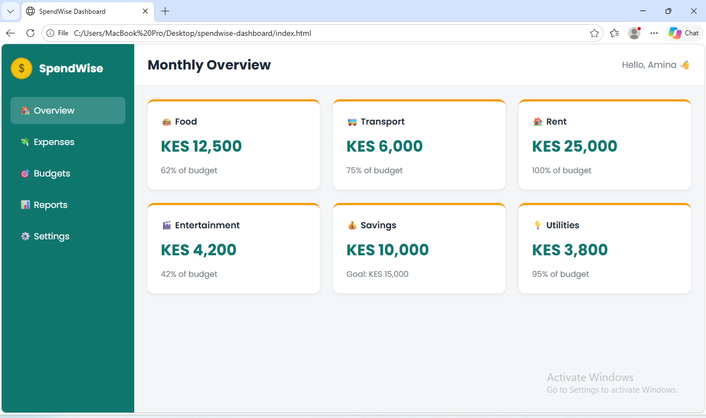

# SpendWise Dashboard

A responsive budget dashboard that shows monthly spending by category (Food, Transport, Rent, Entertainment, Savings, Utilities).

## Features

- Sidebar navigation: Overview, Expenses, Budgets, Reports, Settings
- Header built with Flexbox
- Budget cards in a grid: 3 columns on desktop, 1 column on mobile
- Mobile layout below 768px (sidebar on top, cards stacked)
- Dark theme that follows the device setting (prefers-color-scheme: dark)

## Screenshots

### Desktop

### Mobile (400px)

## How to run

1. Download or clone this folder.
2. Open index.html in your browser.

## Built with

HTML, CSS (Flexbox, Grid, CSS variables, media queries) and JavaScript

## What SpendWise does

SpendWise is a budgeting dashboard. The JavaScript lets users enter a
budget and an expense and see their remaining balance.

## JavaScript concepts implemented

Variables, data types, prompts for input, arithmetic, conditionals,
functions and console output.

## How variables are used

I used `let` for values that change (budget, expense, balance) and
`const` for the fixed currency, "KES".

## How user input is collected

Users type into HTML forms and inputs instead of `prompt()`. The values are
read with `.value` and converted with `Number()`.

## How calculations are performed

The remaining balance is the budget minus the total of all expenses, calculated
by `calculateBalance()`. The total is added up with a `for` loop in
`calculateTotal()`.

## How functions help organize the code

Functions such as `calculateTotal()`, `calculateBalance()`, `getStatus()`,
`renderExpenses()` and `updateDashboard()` keep the logic reusable and
separate from the page events.

## What improved this week

SpendWise changed from a console-only script into an interactive dashboard.
Users can set a budget, add and delete expenses, and see the results on the page.

## How conditionals are used

`if / else if / else` checks what percentage of the budget has been used and
shows a "within budget", "warning" or "over budget" message. Conditionals also
check that the form input is valid.

## How arrays are used to store data

All expenses are stored in an `expenses` array. Each expense is an object with
a name, an amount and a category.

## How loops are used

A `for` loop adds up the total spending. Another `for` loop builds the expense
list shown on the page.

## How the DOM is updated

I select elements with `getElementById` and change them with `textContent`,
`createElement` and `appendChild`, so the page updates without reloading.

## How user interactions are handled through events

`submit` events on the forms add the budget and the expenses. `click` events on
the Delete and Clear All buttons remove data.

## Challenges and how I solved them

At first my `script.js` was created as a folder instead of a file, so the
page did not run my code. I deleted the folder and created a real file.
I also got `NaN` when I typed text into a number prompt, which I fixed by
using number inputs and validating the values.

## Author

Sowda Ahmed Abdi