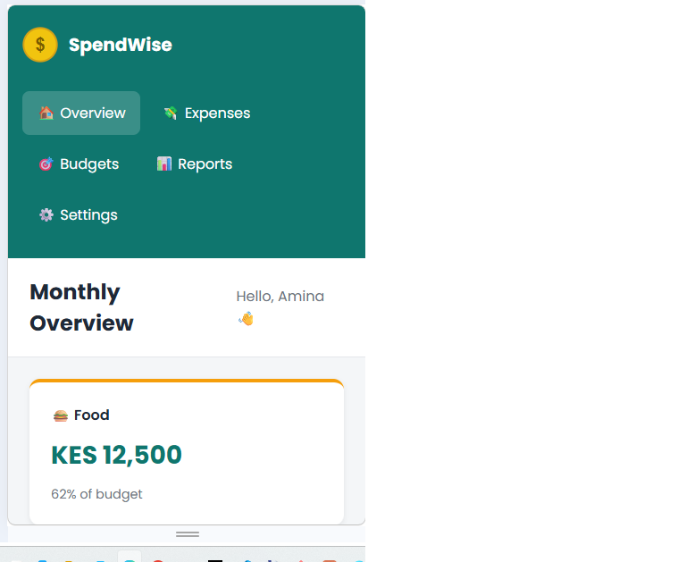

# SpendWise Dashboard

A responsive budget dashboard that shows monthly spending by category (Food, Transport, Rent, Entertainment, Savings, Utilities).

## Features

- Sidebar navigation: Overview, Expenses, Budgets, Reports, Settings
- Header built with Flexbox
- Budget cards in a grid: 3 columns on desktop, 1 column on mobile
- Mobile layout below 768px (sidebar on top, cards stacked)
- Dark theme that follows the device setting (prefers-color-scheme: dark)

## Screenshots

### Desktop

### Mobile (400px)

## How to run

1. Download or clone this folder.
2. Open index.html in your browser.

## Built with

HTML, CSS (Flexbox, Grid, CSS variables, media queries) and JavaScript

## What SpendWise does

SpendWise is a budgeting dashboard. The JavaScript lets users enter a
budget and an expense and see their remaining balance.

## JavaScript concepts implemented

Variables, data types, prompts for input, arithmetic, conditionals,
functions and console output.

## How variables are used

I used `let` for values that change (budget, expense, balance) and
`const` for the fixed currency, "KES".

## How user input is collected

`prompt()` asks for the name, monthly budget, expense name and amount.
`Number()` converts the budget and amount from text to numbers.

## How calculations are performed

The remaining balance is the monthly budget minus the expense, done by
`calculateRemainingBalance()`.

## How functions help organize the code

`calculateRemainingBalance()` and `checkBudgetStatus()` keep the logic
reusable and separate from the input and output.

## Author

Sowda Ahmed Abdi